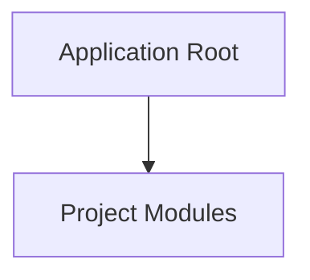

<!-- BRIEF: COMMIT=950f104d HASH=079dbe1a DATE=2026-10-27T08:27:39.073Z -->
# Project Brief: web
- **Commit**: `950f104d` | **Updated**: 2026-10-27T08:27:39.073Z | **Files Tracked**: 59

## Overview
No README.md found.

## Tech Stack
- Node.js / JavaScript/TypeScript (name: purge-mac-replica)

## Project Map (Directory Tree)
```text
.
├── .agent/ (5 files)
├── assets/ (8 files)
│   ├── agent-guard/ (6 files)
│   └── dynamo/ (2 files)
├── css/ (3 files)
├── js/ (3 files)
├── public/ (29 files)
│   ├── agent-guard/ (6 files)
│   ├── clears/ (4 files)
│   ├── dynamo/ (2 files)
│   └── fonts/ (7 files)
├── src-analysis/ (6 files)
│   └── chunks/ (3 files)
├── agent-guard.html
├── dynamo.html
├── index.html
├── package.json
└── server.js
```

## Architecture Chart


## Likely Entry Points
- `index.html`
- `js/main.js`
- `server.js`

## Key Commands
- `npm run start`: `node server.js`
- `npm run dev`: `node server.js`
- `npm run test`: `node -e "const http = require('http'); const req = http.get('http://localhost:3000', res => { console.log('HTTP Status:', res.statusCode); process.exit(res.statusCode === 200 ? 0 : 1); }); req.on('error', err => { console.error(err); process.exit(1); });"`
