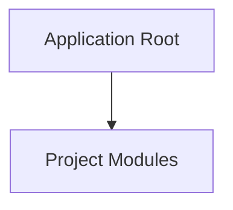

<!-- BRIEF: COMMIT=4436ea47 HASH=e0046ebe DATE=2026-10-27T08:05:21.822Z -->
# Project Brief: web
- **Commit**: `4436ea47` | **Updated**: 2026-10-27T08:05:21.822Z | **Files Tracked**: 5

## Overview
No README.md found.

## Tech Stack
- Generic / Stack undetected

## Project Map (Directory Tree)
```text
.
└── .agent/ (5 files)
```

## Architecture Chart


## Likely Entry Points
- None identified

## Key Commands
- No build/test scripts found
