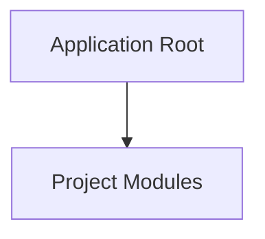

<!-- BRIEF: COMMIT=mtime-17 HASH=2b09dd5b DATE=2026-10-27T08:00:39.864Z -->
# Project Brief: web
- **Commit**: `mtime-17` | **Updated**: 2026-10-27T08:00:39.864Z | **Files Tracked**: 1

## Overview
No README.md found.

## Tech Stack
- Generic / Stack undetected

## Project Map (Directory Tree)
```text
.
└── .agent/ (1 file)
```

## Architecture Chart


## Likely Entry Points
- None identified

## Key Commands
- No build/test scripts found
