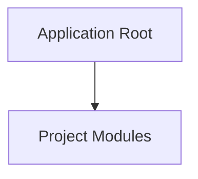

# Project Map & Architecture: web
Generated on: 2026-10-27T10:14:50.641Z | Total Tracked Files: 69

## Architecture Flowchart


## Directory Structure Map
```text
.
├── .agent/ (6 files)
├── assets/ (14 files)
│   ├── agent-guard/ (6 files)
│   ├── agrigence/ (6 files)
│   └── dynamo/ (2 files)
├── css/ (4 files)
├── fonts/ (7 files)
├── js/ (4 files)
├── public/ (24 files)
│   ├── agent-guard/ (6 files)
│   ├── agrigence/ (6 files)
│   ├── dynamo/ (2 files)
│   └── fonts/ (7 files)
├── LICENSE
├── README.md
├── agent-guard.html
├── apple-touch-icon.png
├── dynamo.html
├── favicon.ico
├── index.html
├── og-image-v2.png
├── package.json
└── server.js
```
