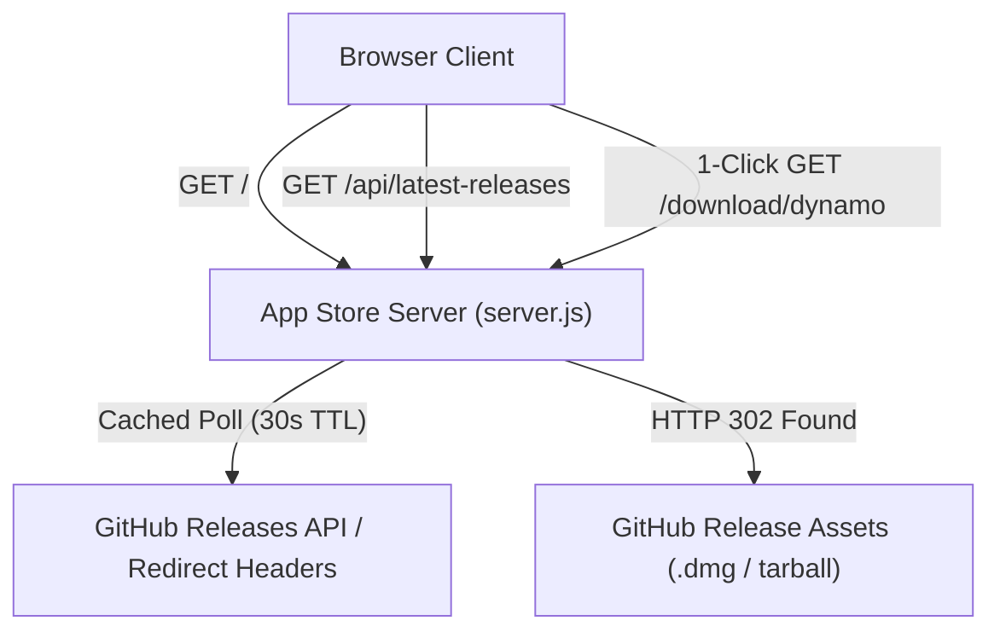

<div align="center">
  
  <h1>App Store by Agrigence</h1>
  <p><strong>Premier macOS utilities, Dynamic Island enhancements, and autonomous developer tools.</strong></p>

  <p>
    <a href="https://github.com/anksarvesh-lgtm/webstore"></a>
    <a href="https://github.com/anksarvesh-lgtm/webstore/blob/main/LICENSE"></a>
    
    
    
  </p>
</div>

---

## 🌟 Overview

**App Store by Agrigence** is a curated, open-source macOS software hub designed with authentic Apple App Store aesthetics. It provides instant 1-click downloads, interactive in-browser simulators, and automatic release synchronization directly from official GitHub releases.

Every application listed operates strictly with **zero external telemetry**, complete local privacy, and native macOS architecture optimization.

---

## 🚀 Featured Applications

### 1. [LiquidDynamo](https://github.com/anksarvesh-lgtm/dynamo-mac) — *Beyond the Notch*
*Category: Utilities · Architecture: Swift 6.4 + Metal + SceneKit*

Turn your MacBook notch into an interactive hardware powerhouse:
- **Fluid Hardware Wings:** Sub-pixel liquid antialiasing displaying real-time CPU, GPU, memory pressure, and battery telemetry.
- **SceneKit 3D Device Universe:** Gesture-controlled 3D orbital space models with realistic Metal shaders.
- **Multi-Network Bonding:** Unified network monitoring combining Wi-Fi and cellular connections with automated failover tracking.
- **Zero Idle Wakeups:** Consumes 0.0% CPU and zero wakeups per second when idle in the menu bar.
- **Product Page:** [dynamo.html](dynamo.html) · **Direct Download:** `/download/dynamo`

---

### 2. [Agent Guard](https://github.com/anksarvesh-lgtm/agent-guard) — *Autonomous Agent Supervisor*
*Category: Developer Tools · Architecture: Node.js + TypeScript MCP*

Production supervisor for autonomous AI coding agents across Claude, Gemini, Antigravity, and Cursor:
- **Atomic DAG Task Ledger:** Strict checkpoint and rollback protection via `.agent/ledger.json` preventing graph corruption.
- **Keep-Awake Assertion Leases:** Native macOS assertion daemon preventing laptop sleep during long-running builds.
- **1% Quota Auto-Rotator:** Proactive credential switcher automatically rotating API keys when token budgets reach <= 1%.
- **Token Compressor & Code Map:** Semantic AST indexing reducing unnecessary file reads by up to 84%.
- **144/144 Test Suite:** Verified 100% green test coverage with built-in `cli.js doctor`.
- **Product Page:** [agent-guard.html](agent-guard.html) · **Direct Download:** `/download/guard`

---

## 💎 Storefront Features

- **macOS App Store Design System:** Curated glass acrylic navigation, Today editorial spotlight cards, #1 / #2 Top Free charts, 5-column metrics ribbons (Rating, Rank, Age, Platform, Engine), and What's New changelogs.
- **Live Search & Keyboard Shortcut (`⌘K` / `/`):** Instant client-side search filtering across names, keywords, and features.
- **Interactive Test Flight:** An embedded MacBook notch simulator in pure CSS and vanilla JavaScript allowing users to test fluid wing mechanics before downloading.
- **Auto-Sync Release Engine:** A resilient server-side cache and direct 302 download redirector ensuring users always receive the latest release without hitting GitHub API rate limits.
- **Privacy First:** Zero Google Analytics, zero tracking cookies, zero remote logging.

---

## 🛠️ Architecture & Release Engine



---

## 💻 Local Development

### Prerequisites
- Node.js 18.0.0 or later
- npm or pnpm

### Quick Start
```bash
# Clone the repository
git clone https://github.com/anksarvesh-lgtm/webstore.git
cd webstore

# Start local server
npm run dev
```

Visit `http://localhost:3000` in your browser.

### Available Routes

| Route | Description |
| :--- | :--- |
| `/` or `/index.html` | App Store by Agrigence storefront with Discover spotlight & Top Charts |
| `/dynamo` or `/dynamo.html` | LiquidDynamo App Store product page with metrics ribbon & preview |
| `/agent-guard` or `/agent-guard.html` | Agent Guard App Store product page with install prompt & metrics |
| `/api/latest-releases` | Real-time cached release JSON for all listed applications |
| `/download/dynamo` | 302 Redirect to latest LiquidDynamo Universal DMG release |
| `/download/guard` | 302 Redirect to latest Agent Guard official release |

---

## 📁 Repository Structure

```text
webstore/
├── assets/
│   ├── agrigence/        # Official Agrigence brand icons (1024px to 32px)
│   ├── agent-guard/      # Agent Guard logo and emblem vector assets
│   └── dynamo/           # LiquidDynamo squircle icons and previews
├── css/
│   ├── appstore.css      # macOS App Store design system & components
│   ├── styles.css        # Base design tokens, typography, and layout
│   ├── dynamo.css        # Interactive notch simulator & hardware wings
│   └── guard.css         # Agent Guard MCP supervisor visual elements
├── js/
│   ├── appstore.js       # Live search, category tabs, and store navigation
│   ├── github-releases.js# Background release sync and direct download updater
│   ├── dynamo.js         # Interactive notch simulator physics controller
│   └── guard.js          # Terminal copy and interactive prompt controllers
├── public/               # Static assets served at web root
├── index.html            # Main App Store storefront
├── dynamo.html           # LiquidDynamo product detail page
├── agent-guard.html      # Agent Guard product detail page
├── server.js             # Express-free Node.js HTTP server with release cache
└── package.json          # Package manifest and verification scripts
```

---

## 🔒 Security & Verification

- **Code Review:** All releases are reviewed under Agent Guard atomic ledger supervision.
- **Transport Security:** Pre-configured with HTTPS-ready secure headers (`X-Content-Type-Options: nosniff`, `X-Frame-Options: SAMEORIGIN`).
- **Universal Binaries:** Applications are compiled natively for both Apple Silicon (ARM64) and Intel (x86_64).

---

## 📄 License

Architected by [Sarvesh](https://github.com/anksarvesh-lgtm) under the [Apache 2.0 License](LICENSE). Built for macOS.
